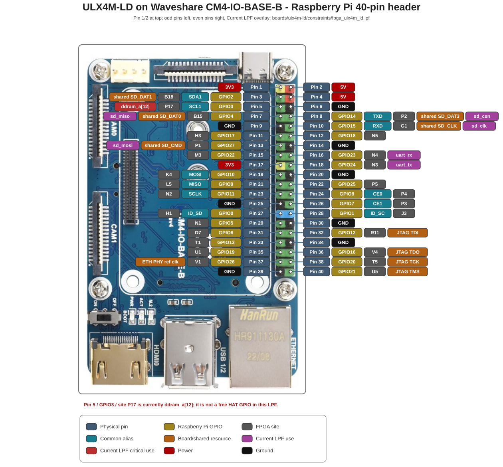

# ULX Pinout Generator

Generate annotated pinout diagrams for ULX FPGA boards from board-specific
constraint files, connector maps, and board images.

The project currently supports:


Samples:

| Output samples |
|  :---: |
| ULX3S J1/J2 GPIO headers  |
| <a href="./output/ulx3s/pinout_ulx3s.svg"></a> |  
| ULX4M-LD on the <br /> Waveshare CM4-IO-BASE-B <br> Raspberry Pi 40-pin header |
| <a href="./output/ulx4m-ld/pinout_ulx4m_ld.svg"></a>  |

The top-level scripts are board-independent. Board-specific connector maps,
LPF interpretation, generated data, image assets, and layout geometry live
under `boards/<board>/`.

> WARNING: This project is under development. Always verify connector power,
> FPGA sites, board-revision details, shared resources, and connector
> orientation against the board schematic and the selected constraint file
> before connecting external hardware.

## Repository layout

```text
ulx3s-pinout/
|-- .github/
|   `-- workflows/
|       `-- test-pinout.yml
|-- generate-pinout.py
|-- generate-data-from-lpf.py
|-- pinout_common.py
|-- styles.css
|-- scripts/
|   `-- test-pinout.sh
|-- boards/
|   |-- ulx3s/
|   |   |-- data.py
|   |   |-- generator.py
|   |   |-- layout.py
|   |   |-- ulx3s.png
|   |   `-- constraints/
|   |       |-- ulx3s_v17patch.lpf
|   |       |-- ulx3s_v20.lpf
|   |       |-- ulx3s_v314.lpf
|   |       `-- ulx3s_v316.lpf
|   `-- ulx4m-ld/
|       |-- data.py
|       |-- generator.py
|       |-- layout.py
|       |-- cm4-io-base-b-3_3.jpg
|       `-- constraints/
|           |-- fpga_ulx4m_ld.lpf
|           |-- fpga_ulx4m_ld_blinky.lpf
|           `-- fpga_ulx4m_ld_v002.lpf
|-- output/
|   |-- ulx3s/
|   `-- ulx4m-ld/
`-- build/
    `-- pinout-tests/
```

`generator.py` is intentionally board-specific. It keeps ULX3S GP/GN parsing
and ULX4M Raspberry Pi/CM4 mapping out of the shared top-level dispatcher.

## Requirements

For Ubuntu or WSL:

```bash
sudo apt update
sudo apt install python3-pip

python3 -m pip install --user --upgrade pinout cairosvg pillow
```

The dependencies are used as follows:

- `pinout` builds the diagram object model and exports SVG.
- `cairosvg` is required for PNG, PDF, and PS output.
- `Pillow` is used for image validation and for EXIF-normalizing the Waveshare
  CM4 carrier photograph before applying calibrated header coordinates.

Run generation commands from the repository root because board definitions
refer to repository-relative files.

## Clone the repository

```bash
cd /mnt/c/workspace
git clone https://github.com/ulx3s/ulx3s-pinout.git
cd ulx3s-pinout
```

## Quick start

### ULX3S

Regenerate the default ULX3S data from the v3.1.6/v3.1.7 LPF and include the
recognized aliases used by the committed pinout:

```bash
./generate-data-from-lpf.py ulx3s \
    --include aliases \
    --markdown output/ulx3s/PIN-MAPPING.md
```

Generate the SVG:

```bash
./generate-pinout.py ulx3s
```

Generate the PNG:

```bash
./generate-pinout.py ulx3s --format png
```

Default outputs:

```text
output/ulx3s/pinout_ulx3s.svg
output/ulx3s/pinout_ulx3s.png
output/ulx3s/PIN-MAPPING.md
```

To generate ULX3S data from another checked-in LPF:

```bash
./generate-data-from-lpf.py ulx3s \
    boards/ulx3s/constraints/ulx3s_v20.lpf \
    --include aliases \
    --markdown output/ulx3s/PIN-MAPPING-v20.md
```

Show all ULX3S-specific generator options:

```bash
./generate-data-from-lpf.py ulx3s --help
```

### ULX4M-LD

Regenerate the ULX4M-LD data from the default LPF:

```bash
./generate-data-from-lpf.py ulx4m-ld \
    --markdown output/ulx4m-ld/PIN-MAPPING.md
```

Generate the SVG:

```bash
./generate-pinout.py ulx4m-ld
```

Generate the PNG:

```bash
./generate-pinout.py ulx4m-ld --format png
```

Default outputs:

```text
output/ulx4m-ld/pinout_ulx4m_ld.svg
output/ulx4m-ld/pinout_ulx4m_ld.png
output/ulx4m-ld/PIN-MAPPING.md
```

The ULX4M data generator keeps two distinct layers of information:

- fixed Raspberry Pi header -> CM4 -> ULX4M-LD FPGA-site mapping
- current LPF use of those FPGA sites

That distinction is important because a header-connected FPGA site can also be
consumed by another design resource. With the current `fpga_ulx4m_ld.lpf`,
Raspberry Pi header pin 5 / GPIO3 / FPGA site P17 is used by
`ddram_a[12]`, so the diagram marks it as a critical current LPF use.

## Generate all boards

```bash
./generate-pinout.py all
```

The board data must already be generated. `generate-pinout.py` renders the
existing `boards/<board>/data.py`; it does not silently choose or regenerate a
constraint-file configuration.

## Output formats

Supported formats are:

```text
svg
png
pdf
ps
```

Examples:

```bash
./generate-pinout.py ulx3s --format svg
./generate-pinout.py ulx3s --format png
./generate-pinout.py ulx4m-ld --format pdf
./generate-pinout.py ulx4m-ld --format ps
```

For a custom filename when generating one board:

```bash
./generate-pinout.py ulx4m-ld \
    --format svg \
    --output output/ulx4m-ld/custom.svg
```

By default, generation overwrites the selected output file. Use
`--no-overwrite` to retain the existing file and let `pinout.manager` choose a
unique output name.

## Direct pinout.manager use

Each board `layout.py` exposes a module-level object named `diagram`, so the
original `pinout.manager` workflow remains available.

ULX3S:

```bash
python3 -m pinout.manager \
    --export boards/ulx3s/layout.py output/ulx3s/pinout_ulx3s.svg \
    --overwrite
```

ULX4M-LD:

```bash
python3 -m pinout.manager \
    --export boards/ulx4m-ld/layout.py output/ulx4m-ld/pinout_ulx4m_ld.svg \
    --overwrite
```

The top-level `generate-pinout.py` is the preferred board-oriented front end.

## Script validation

Run the same parser and rendering checks used by GitHub Actions locally:

```bash
./scripts/test-pinout.sh
```

The test script writes temporary results only below:

```text
build/pinout-tests/
```

It validates:

- Python syntax for the root and board-specific Python files
- board discovery and command-line help
- rendering of ULX3S and ULX4M-LD as SVG and PNG
- PNG readability and non-zero image dimensions
- reproducibility of the committed default `data.py` files
- Markdown mapping generation
- every checked-in ULX3S constraint file
- every checked-in ULX4M-LD constraint file
- the ULX3S aliases path
- ShellCheck for the test script when ShellCheck is available
- that the test does not modify tracked repository files

A successful run always contains these rendered images:

```text
build/pinout-tests/rendered/pinout_ulx3s.svg
build/pinout-tests/rendered/pinout_ulx3s.png
build/pinout-tests/rendered/pinout_ulx4m_ld.svg
build/pinout-tests/rendered/pinout_ulx4m_ld.png
```

GitHub Actions runs the test suite on the configured Python matrix. Each matrix
job uploads its rendered SVG/PNG images, generated Markdown/data files, and
constraint-sweep outputs as a downloadable artifact.

The workflow is:

```text
.github/workflows/test-pinout.yml
```

## Source and generated files

The normal data flow is:

```text
ULX3S LPF ------------------+
                            |
                            v
boards/ulx3s/generator.py -> boards/ulx3s/data.py
                                      |
boards/ulx3s/ulx3s.png ---------------+
styles.css ----------------------------+--> boards/ulx3s/layout.py
                                                   |
                                                   v
                                      output/ulx3s/pinout_ulx3s.*

ULX4M-LD LPF --------------+
                            |
                            v
boards/ulx4m-ld/generator.py -> boards/ulx4m-ld/data.py
                                         |
boards/ulx4m-ld/cm4-io-base-b-3_3.jpg ---+
styles.css -------------------------------+--> boards/ulx4m-ld/layout.py
                                                      |
                                                      v
                                  output/ulx4m-ld/pinout_ulx4m_ld.*
```

Treat the LPF files, board-specific generators, layout code, board images, and
shared stylesheet as source. Regenerate `data.py` and diagrams rather than
making permanent edits directly to generated SVG/PNG output.

The board images are embedded in the generated SVG, so normal viewing of the
SVG does not require network access.

## Shared vs board-specific code

### `generate-data-from-lpf.py`

This is a board-neutral dispatcher. The first positional argument selects the
board and the remaining options are passed to that board's generator.

List supported boards:

```bash
./generate-data-from-lpf.py --list-boards
```

Examples:

```bash
./generate-data-from-lpf.py ulx3s --include aliases
./generate-data-from-lpf.py ulx4m-ld
```

### `generate-pinout.py`

This is the board-neutral renderer. It loads the selected board's `layout.py`
and exports the requested format.

List supported boards:

```bash
./generate-pinout.py --list-boards
```

### `pinout_common.py`

Contains shared filesystem/module-loading helpers, image normalization, SVG
escaping, and coordinate interpolation. It intentionally does not know ULX3S
J1/J2 numbering or the ULX4M CM4 GPIO map.

The filename uses an underscore so it can be imported as a normal Python
module.

### `styles.css`

Contains styles shared by both diagrams. ULX4M-specific rules are scoped below
`.ulx4m` so Raspberry Pi GPIO, alias, and active-LPF styling does not override
the existing ULX3S pinout component classes.

For compatibility with the PNG conversion path, use conventional comma
separated `rgb()` values, for example:

```css
fill: rgb(34, 173, 0);
```

rather than CSS Color 4 space-separated syntax.

### Board `generator.py`

Each board generator owns the mapping rules that cannot safely be generalized.

`boards/ulx3s/generator.py` owns:

- GP/GN vector and scalar forms
- J1/J2 physical connector templates
- differential GP/GN classification
- LPF aliases and optional metadata
- vector/scalar consistency checks
- generated Markdown pin mapping

`boards/ulx4m-ld/generator.py` owns:

- Raspberry Pi physical pin definitions
- BCM GPIO aliases
- CM4 GPIO to ECP5 site mapping
- SD/JTAG/Ethernet shared-resource notes
- current LPF `LOCATE COMP` matching
- generated Markdown pin mapping

### Board `layout.py`

A board layout owns image placement and drawing geometry only. Both layouts
expose `diagram` for compatibility with `pinout.manager`.

For ULX4M-LD, four measured header endpoints are authoritative. The 20 header
row centers are interpolated from those endpoints so the labels and leader
lines stay aligned with the photographed connector pins.

## ULX3S details

### Header numbering convention

The physical J1 and J2 pin numbers follow the ULX3S constraint-file convention
for female angled 90-degree headers mounted on the top of the board.

The ULX3S constraint files describe the GPIO connectors as either:

- female angled 90-degree headers on the top, or
- male vertical headers on the bottom / flat cable

If using a male vertical header, confirm the physical orientation before
wiring. Do not assume that apparent left/right or odd/even positions are the
same when viewed from the opposite side of the PCB.

The generated data validates that:

```text
J1 contains physical pins 1..40 exactly once
J2 contains physical pins 1..40 exactly once
GP0..GP27 appear exactly once
GN0..GN27 appear exactly once
```

### ULX3S pin data organization

`boards/ulx3s/data.py` separates the two physical rows of each 2x20 connector
so each physical header pin can be connected to its own label group.

The main connector data sets are:

```text
left_header_even     J1 even-numbered physical pins
left_header_odd      J1 odd-numbered physical pins
right_header_even    J2 even-numbered physical pins
right_header_odd     J2 odd-numbered physical pins
```

The GPIO signal range is:

```text
J1: GP0..GP13 and GN0..GN13
J2: GP14..GP27 and GN14..GN27
```

When changing or reviewing generated mappings, verify FPGA package sites
against the selected LPF instead of inferring them from neighboring pins.

### Generate ULX3S data from an LPF

The ULX3S generator makes FPGA-site labels reproducible from an authoritative
constraint file instead of maintaining those package sites by hand.

Base pinout:

```bash
./generate-data-from-lpf.py ulx3s \
    boards/ulx3s/constraints/ulx3s_v316.lpf
```

Committed/default pinout with aliases:

```bash
./generate-data-from-lpf.py ulx3s \
    boards/ulx3s/constraints/ulx3s_v316.lpf \
    --include aliases
```

Write to a temporary data file instead of replacing the committed board data:

```bash
./generate-data-from-lpf.py ulx3s \
    boards/ulx3s/constraints/ulx3s_v20.lpf \
    -o build/ulx3s-v20-data.py
```

### Optional ULX3S LPF labels

Use `--include` to add selected LPF-derived information to the generated pin
labels.

Available fields include:

```text
aliases
connector
flags
iobuf
pullmode
io_type
drive
frequency
comment
all
```

Show the generator's authoritative current field list with:

```bash
./generate-data-from-lpf.py ulx3s --list-fields
```

Examples:

Revision-specific aliases:

```bash
./generate-data-from-lpf.py ulx3s \
    boards/ulx3s/constraints/ulx3s_v316.lpf \
    --include aliases
```

Useful electrical metadata without the complete raw comment:

```bash
./generate-data-from-lpf.py ulx3s \
    boards/ulx3s/constraints/ulx3s_v316.lpf \
    --include aliases,connector,flags,pullmode,io_type,drive,frequency
```

Every parsed IOBUF key/value:

```bash
./generate-data-from-lpf.py ulx3s \
    boards/ulx3s/constraints/ulx3s_v316.lpf \
    --include iobuf
```

A specific arbitrary IOBUF key:

```bash
./generate-data-from-lpf.py ulx3s \
    boards/ulx3s/constraints/ulx3s_v316.lpf \
    --iobuf-key SLEWRATE
```

`--include aliases` combines recognized aliases found in the GP/GN inline
comment with other active `LOCATE COMP` signal names using the same FPGA site.
Duplicate aliases are emitted only once.

`--include connector` emits connector labels such as `J1_5+`, `J1_5-`,
`J2_35+`, and `J2_35-`. If the LPF provides an explicit connector token in the
GP/GN comment, the generator verifies it against the physical connector
template.

`--include flags` extracts useful GP/GN comment flags such as `DIFF`, `PCLK`,
and `GR_PCLK`.

`--include iobuf` emits every parsed IOBUF `KEY=VALUE` pair. The narrower
`pullmode`, `io_type`, and `drive` fields can be requested individually.

`--include frequency` emits `FREQUENCY PORT` metadata when present.

`--include comment` emits the complete GP/GN inline comment. This can create
very wide labels and is mainly useful for auditing.

`--include all` enables all supported optional fields, including the raw
comment.

### Vector and scalar ULX3S GPIO definitions

Some ULX3S LPFs contain both vector and scalar forms:

```text
gp[0]..gp[27] / gn[0]..gn[27]
gp0..gp27     / gn0..gn27
```

The generator verifies that the two forms use the same FPGA `SITE`.

For aliases and electrical metadata, the forms are not blindly merged.
`--gpio-form auto` is the default and prefers the complete vector form.

Choose a form explicitly when required:

```bash
--gpio-form vector
--gpio-form scalar
```

`ulx3s_v316.lpf` currently contains a known GN12 vector/scalar metadata
difference. The generator reports it as a warning:

```text
vector: PULLMODE=UP, IO_TYPE=LVCMOS33, DRIVE=4, no FREQUENCY
scalar: PULLMODE=NONE, IO_TYPE=LVCMOS33, FREQUENCY=50 MHZ
```

The warning is expected during the normal test suite. Use
`--strict-form-metadata` when such differences should be treated as fatal.

### ULX3S user labels

Project/user labels are independent of LPF metadata. The generator can include
labels such as the example UART annotations for GP0 and GP1.

Suppress user labels with:

```bash
--no-user-labels
```

Use `--include` for LPF-derived information and the user-label mechanism for
project-specific semantic labels; do not encode project-only labels into the
constraint parser.

### Generated Python formatting

Generated `data.py` intentionally uses stable double-quoted strings rather than
Python `repr()` output. This minimizes noisy diffs when data is regenerated.

## Editing the diagrams

### Change a pin mapping or LPF-derived label

Prefer changing the authoritative board constraint or board-specific generator,
then regenerate `data.py`.

For ULX3S:

```text
boards/ulx3s/generator.py
boards/ulx3s/constraints/*.lpf
```

For ULX4M-LD:

```text
boards/ulx4m-ld/generator.py
boards/ulx4m-ld/constraints/*.lpf
```

Do not permanently hand-edit an FPGA package site in generated `data.py` unless
the intent is specifically to change the generated format/template.

### Change label or leader-line placement

Edit the board's layout:

```text
boards/ulx3s/layout.py
boards/ulx4m-ld/layout.py
```

Layout code owns:

- diagram dimensions
- board-image placement
- label-group positions
- leader-line geometry
- semantic label widths
- label height and spacing
- board centering
- legend placement
- board-specific calibration coordinates

For ULX4M-LD, keep the measured header endpoint calibration separate from label
placement. The connector geometry should remain authoritative so moving labels
does not change which photographed pin a leader line targets.

### Change label widths

ULX3S label widths are selected by semantic type so short labels remain compact
while aliases and metadata receive more room.

The layout uses width categories such as:

```text
PIN_NUMBER_LABEL_WIDTH
GPIO_SIGNAL_LABEL_WIDTH
FPGA_SITE_LABEL_WIDTH
POWER_LABEL_WIDTH
GROUND_LABEL_WIDTH
USER_LABEL_WIDTH
ALIAS_LABEL_WIDTH
CONNECTOR_LABEL_WIDTH
METADATA_LABEL_WIDTH
ANALOG_LABEL_WIDTH
PWM_LABEL_WIDTH
TOUCH_LABEL_WIDTH
DEFAULT_LABEL_WIDTH
```

Physical connector numbers are recognized by numeric content first. Other
labels select their width from their semantic tag.

If a new label tag is added, assign it an appropriate width or allow it to use
the default width.

### Change pill appearance

ULX3S pill geometry is parameterized in `boards/ulx3s/layout.py`, including
settings for corner radius, border color, and border width.

`styles.css` controls shared visual styling such as:

- GP/GN colors
- differential pair colors
- FPGA-site colors
- power and ground
- aliases
- connector metadata
- ULX4M physical-pin/GPIO/active-resource colors
- leader lines
- fonts
- legend styling

Keep board-specific CSS scoped when a class name could otherwise affect both
boards.

## ULX4M-LD details

### Raspberry Pi header orientation

The ULX4M-LD diagram is drawn against the Waveshare CM4-IO-BASE-B carrier
photograph. The Raspberry Pi compatible 40-pin header is treated as a vertical
2x20 connector.

The layout uses measured endpoints for:

```text
odd pin 1
odd pin 39
even pin 2
even pin 40
```

The intermediate pin centers are interpolated from those points. This lets
labels be moved without losing alignment to the actual photographed connector.

### Shared resources

The ULX4M-LD header mapping includes both connector identity and board/design
sharing information.

Examples include:

- SD-related signals sharing Raspberry Pi header GPIOs
- FPGA JTAG signals connected to Raspberry Pi header GPIOs
- Ethernet reference-clock sharing
- current LPF use of header-connected FPGA sites

These are intentionally distinct label categories. A fixed board connection is
not the same thing as the active use chosen by one LPF.

### Current LPF usage

The default ULX4M-LD LPF currently uses these header-connected sites:

```text
pin  5  GPIO3   P17  ddram_a[12]
pin  7  GPIO4   B15  sd_miso
pin  8  GPIO14  P2   sd_csn
pin 10  GPIO15  G1   sd_clk
pin 13  GPIO27  P1   sd_mosi
pin 16  GPIO23  N4   uart_rx
pin 18  GPIO24  N3   uart_tx
```

The generator derives this layer from the selected LPF rather than hard-coding
those active signal names into the drawing code.

## Troubleshooting

### `module '<name>' has no attribute 'diagram'`

`pinout.manager` expects a module-level object named:

```python
diagram
```

Each board `layout.py` must expose that object.

### PNG export fails while SVG succeeds

The PNG/PDF/PS conversion path is stricter about some CSS syntax than modern
browsers. In particular, use conventional comma-separated RGB values:

```css
rgb(34, 173, 0)
```

not:

```css
rgb(34 173 0)
```

The test script checks for the unsupported space-separated form.

### ULX3S reports the GN12 metadata warning

The v3.1.6/v3.1.7 LPF has different vector/scalar metadata for GN12. The normal
generator reports this as a warning and the CI test allows it.

Use:

```bash
--strict-form-metadata
```

if you want the discrepancy to fail generation.

### `data.py` reproducibility test fails

The test regenerates the committed board data using the repository's default
generation options.

For ULX3S, the committed default includes aliases:

```bash
./generate-data-from-lpf.py ulx3s --include aliases
```

If the committed data was generated with different options, the test prints a
diff so the mismatch is visible.

### Labels render but the board image is missing

Confirm the board image exists at the expected board-specific path:

```bash
ls -lh boards/ulx3s/ulx3s.png
ls -lh boards/ulx4m-ld/cm4-io-base-b-3_3.jpg
```

Both layouts embed the board image into the generated SVG.

### Browser still shows an older SVG

A browser may cache a local SVG. Reload the file or close and reopen the tab
after regeneration.

## Validation checklist

Before committing pinout changes:

1. Run `./scripts/test-pinout.sh` and confirm it reaches
   `Pinout script tests passed.`
2. Open the generated ULX3S SVG/PNG and confirm the board image is visible.
3. Confirm ULX3S J1/J2 labels align with the intended physical connector holes.
4. Confirm ULX4M-LD labels and leader lines align with the photographed 40-pin
   connector.
5. Confirm every ULX3S J1 and J2 physical pin 1..40 appears exactly once.
6. Confirm GP0..GP27 and GN0..GN27 appear exactly once for ULX3S.
7. Verify FPGA package sites against the authoritative constraint file.
8. Verify power and ground against the schematic/manual for the intended board
   revision.
9. For ULX4M-LD, distinguish fixed header wiring from current LPF use and
   shared-resource notes.
10. Check `git diff` and `git status --short` for unintended source or generated
    changes.
11. In GitHub Actions, download the generated artifact and inspect the SVG/PNG
    files for both boards.

Automated checks intentionally complement, rather than replace, visual and
schematic verification.

## Migration from the old flat ULX3S layout

The multi-board refactor moved the original ULX3S responsibilities as follows:

```text
data.py                   -> boards/ulx3s/data.py
pinout_ulx3s.py           -> boards/ulx3s/layout.py
constraints/*             -> boards/ulx3s/constraints/*
ulx3s.png                 -> boards/ulx3s/ulx3s.png
generate-data-from-lpf.py -> shared dispatcher + boards/ulx3s/generator.py
styles.css                -> shared stylesheet for all boards
```

`custom_components.py` is no longer required by the normal generation path.
The current ULX3S layout uses the local board image directly, and the ULX4M
layout uses the shared image-normalization helper.

The old `pinout-update.sh` watcher is also no longer required. One-shot
generation and validation are now board-neutral through `generate-pinout.py`
and `scripts/test-pinout.sh`.

## Optional legacy helper utilities

If the repository still contains the older C# helper projects, they are
separate from the normal Python generation workflow:

- `fpga2pinout/` extracts `LOCATE COMP ... SITE ...` mappings from an FPGA
  constraint file.
- `svg2png/` renders SVG to PNG using SVG.NET.
- `png2base64/` is a legacy Base64 helper.

They are not required to generate the current ULX3S or ULX4M-LD pinouts.

## References

ULX3S:

- [ULX3S FPGA constraint file - ulx3s_v20.lpf](https://github.com/emard/ulx3s/blob/master/doc/constraints/ulx3s_v20.lpf)
- [ULX3S manual](https://github.com/emard/ulx3s/blob/master/doc/MANUAL.md)
- [ULX3S project](https://radiona.org/ulx3s/)

Pinout tooling:

- [pinout documentation](https://pinout.readthedocs.io/)

The checked-in LPF files and board-specific mapping code remain the immediate
inputs used by this repository. External references are useful for independent
verification of connector and board details.
